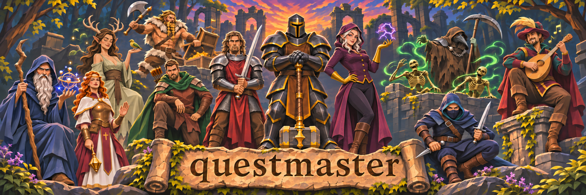

# Questmaster

Questmaster is a native macOS workspace for AI coding agents, backed by a Go CLI
and tmux. Master sessions coordinate workers, while the app brings their
terminals, messages, quests, pull requests, and artifacts together.

Each master has one of eleven fantasy classes, with its own animated avatar and
voice.

## Development

Build the backend with Go 1.25.7 or newer:

```sh
go build -buildvcs=false ./...
```

Running sessions requires tmux and an installed agent harness. The native app
targets macOS 14 or later. See [AGENTS.md](AGENTS.md) for app build instructions,
verification commands, and development guidelines.
